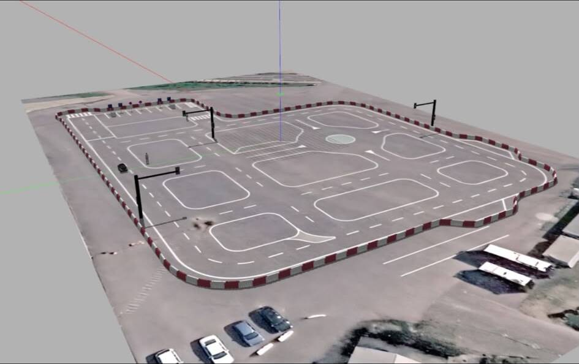
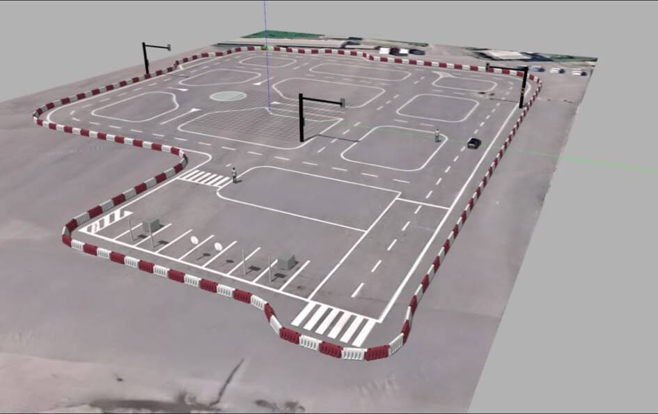
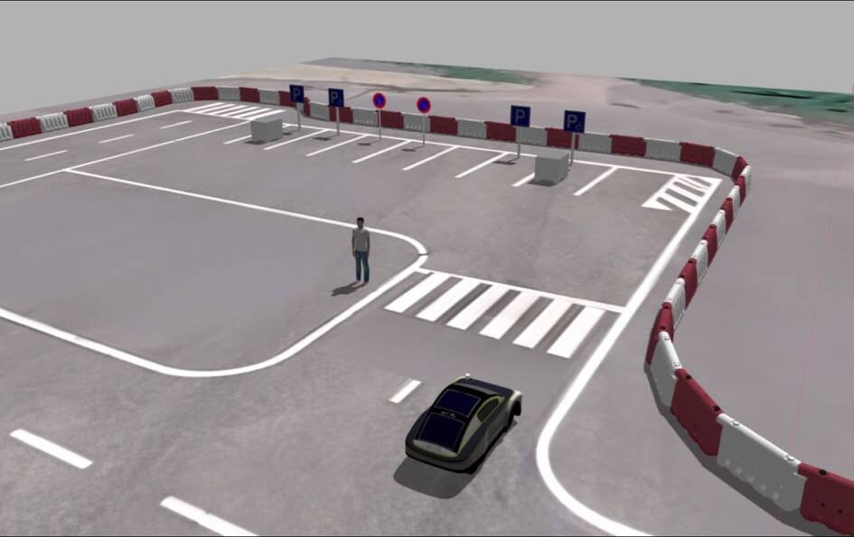
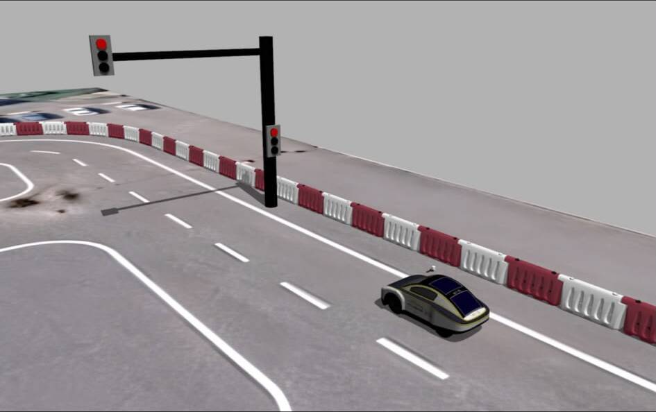
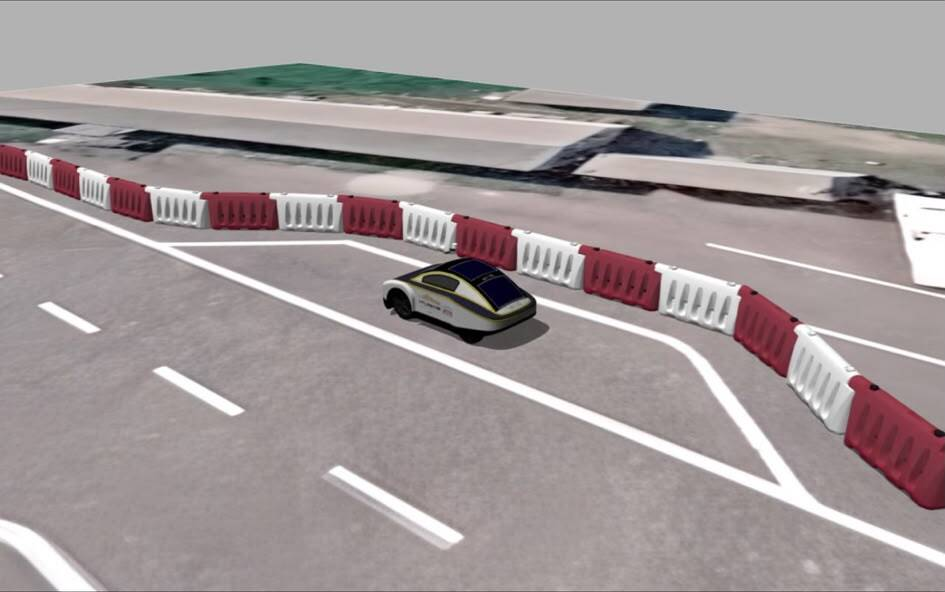

# TEKNOFEST Robotaxi Track in Gazebo

The TEKNOFEST Robotaxi competition track modelled in Blender and imported into
Gazebo Classic for autonomous driving simulation. The model includes lane
markings, intersections, a parking area with signs, pedestrian crossings,
traffic lights, barriers and pedestrians.

<table>
  <tr>
    <td></td>
    <td></td>
  </tr>
  <tr>
    <td align="center">Track seen from the parking side</td>
    <td align="center">Parking area, pedestrian crossing and a pedestrian</td>
  </tr>
  <tr>
    <td></td>
    <td></td>
  </tr>
  <tr>
    <td align="center">Traffic light</td>
    <td align="center">Barriers along the track edge</td>
  </tr>
</table>

Built with Blender, Gazebo Classic and ROS 2.
